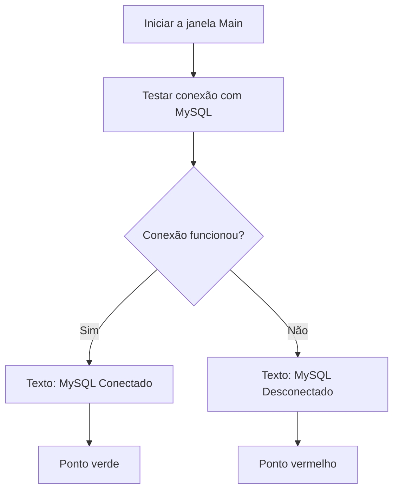

# Java — JDBC, MySQL e Interface Gráfica (BL-PDV)

# 1. Configurando o título da janela

Continuando a configuração do `JFrame` no WindowBuilder:

1. Clique na janela principal na aba `Design`.
2. Procure a propriedade `title`.
3. Clique nos três pontos.
4. Digite o título:

```text
BL-PDV
```

5. Clique em `OK`.

A propriedade `title` define o título que será exibido na barra superior da janela.

---

# 2. JDBC — Conexão entre Java e Banco de Dados

## O que é JDBC?

**JDBC (Java Database Connectivity)** é uma API do Java que permite que aplicações Java se comuniquem com bancos de dados.

Por meio do JDBC, um programa Java pode:

- Conectar-se a um banco de dados.
- Executar comandos SQL.
- Consultar informações.
- Inserir registros.
- Alterar dados.
- Excluir registros.
- Receber resultados das consultas.

Por exemplo, um sistema de ponto de venda (PDV) pode utilizar Java para cadastrar produtos, consultar preços, registrar vendas e armazenar informações no MySQL.

### Como funciona a comunicação?

<box border radius="lg" padding={3} gap={1}>
  <box background="#DCEBFA" theme="light" padding={2} radius="md" align="center">
    **Aplicação Java — BL-PDV**
    <caption>Interface gráfica e código do sistema</caption>
  </box>
  <box align="center">
    <icon name="arrow-down" size="xl"/>
  </box>
  <box background="#E7E1F5" theme="light" padding={2} radius="md" align="center">
    **JDBC + MySQL Connector/J**
    <caption>API e driver de comunicação</caption>
  </box>
  <box align="center">
    <icon name="arrow-down" size="xl"/>
  </box>
  <box background="#DDEBDD" theme="light" padding={2} radius="md" align="center">
    **Banco de Dados MySQL**
    <caption>Armazenamento e execução de SQL</caption>
  </box>
</box>

O Java utiliza o JDBC para solicitar operações ao banco de dados. O driver do MySQL traduz a comunicação necessária para que a aplicação consiga trabalhar com o banco.

## Principais componentes do JDBC

Na aula foram apresentados componentes relacionados à conexão:

| Classe/Interface | Função |
|---|---|
| `DriverManager` | Gerencia os drivers e ajuda a estabelecer conexões. |
| `Connection` | Representa uma conexão estabelecida com o banco de dados. |
| `Statement` | Executa instruções SQL. |
| `ResultSet` | Armazena os resultados de consultas SQL, permitindo percorrê-los. |

Esses componentes serão utilizados conforme o sistema for desenvolvido.

---

# 3. Instalando o MySQL Connector/J

## O que é MySQL Connector/J?

O **MySQL Connector/J** é o driver JDBC oficial para comunicação entre aplicações Java e bancos de dados MySQL.

O Java possui a API JDBC, mas precisa do driver correspondente para se comunicar adequadamente com o MySQL.

Pense no JDBC como uma linguagem comum de comunicação e no Connector/J como o componente que permite ao Java conversar especificamente com o MySQL.

## Passo a passo da instalação

### 1. Acessar o site do MySQL

No navegador:

1. Entre no site oficial do MySQL.
2. Acesse `Downloads`.
3. Selecione `MySQL Community (GPL)`.
4. Procure por `Connector/J`.

### 2. Selecionar a versão

Na aula, foi utilizada a versão:

```text
8.4.0
```

Selecione a plataforma:

```text
Platform Independent
```

Essa opção permite baixar o pacote que não está limitado a um sistema operacional específico.

### 3. Baixar e extrair

Baixe o arquivo ZIP e extraia seu conteúdo.

Dentro da pasta extraída, procure o arquivo:

```text
mysql-connector-j-8.4.0.jar
```

A extensão `.jar` representa um pacote Java que contém classes e recursos necessários para a biblioteca.

### 4. Mostrar as extensões de arquivos no Windows

Caso o Windows não esteja mostrando `.jar`:

1. Abra o Explorador de Arquivos.
2. Clique em `Visualizar`.
3. Entre em `Mostrar`.
4. Marque `Extensões de nome de arquivos`.

Assim será possível identificar o arquivo correto.

### 5. Adicionar o Connector/J ao projeto

No Eclipse:

1. Abra o projeto `blpvd`.
2. Arraste o arquivo `mysql-connector-j-8.4.0.jar` para a pasta `lib`.
3. Clique com o botão direito no arquivo.
4. Selecione `Build Path`.
5. Clique em `Add to Build Path`.

O driver passará a fazer parte das bibliotecas utilizadas pelo projeto.

### Estrutura atual do projeto

```text
blpvd
│
├── src
│   └── view
│       └── Main.java
│
├── lib
│   ├── flatlaf.jar
│   └── mysql-connector-j-8.4.0.jar
│
└── Referenced Libraries
    ├── flatlaf.jar
    └── mysql-connector-j-8.4.0.jar
```

---

# 4. Criando o banco de dados no MySQL Workbench

Agora vamos preparar o banco de dados que será utilizado pelo sistema Java.

Abra o MySQL Workbench e conecte-se à conexão que já estava sendo utilizada nas aulas.

## 4.1 Criando o banco

Execute o comando:

```sql
CREATE DATABASE blpdv
DEFAULT CHARACTER SET utf8
DEFAULT COLLATE utf8_general_ci;
```

### Explicação

- `CREATE DATABASE`: cria um banco de dados.
- `blpdv`: nome do banco de dados.
- `DEFAULT CHARACTER SET utf8`: define a codificação padrão.
- `DEFAULT COLLATE utf8_general_ci`: define a regra de comparação e ordenação de textos.

A collation `utf8_general_ci` é uma configuração que permite comparações de texto sem diferenciar maiúsculas e minúsculas em muitos casos.

> **Atenção ao nome:** mantenha o nome do banco exatamente igual em todos os lugares. Nesta aula, utilizaremos `blpdv` no SQL e na URL do Java.

## 4.2 Selecionando o banco

```sql
USE blpdv;
```

O comando `USE` seleciona o banco de dados que será utilizado nos comandos SQL seguintes.

Assim, não será necessário escrever o nome do banco antes de cada tabela.

---

# 5. Criando a tabela fornecedores

Execute:

```sql
CREATE TABLE fornecedores (
    idFornecedor INT AUTO_INCREMENT,
    nome VARCHAR(50) NOT NULL,
    fone VARCHAR(20) NOT NULL,
    email VARCHAR(50),
    site VARCHAR(100),
    PRIMARY KEY (idFornecedor)
) DEFAULT CHARSET = utf8;
```

## Entendendo a estrutura da tabela

| Campo | Tipo | Descrição |
|---|---|---|
| `idFornecedor` | `INT` | Identificador numérico do fornecedor. |
| `nome` | `VARCHAR(50)` | Nome do fornecedor, com até 50 caracteres. |
| `fone` | `VARCHAR(20)` | Telefone do fornecedor. |
| `email` | `VARCHAR(50)` | E-mail do fornecedor. |
| `site` | `VARCHAR(100)` | Endereço do site do fornecedor. |

### `INT`

Armazena números inteiros.

### `AUTO_INCREMENT`

Faz o MySQL gerar automaticamente um novo número para o identificador conforme os registros são inseridos.

Exemplo:

| idFornecedor | nome |
|---:|---|
| 1 | Fornecedor A |
| 2 | Fornecedor B |
| 3 | Fornecedor C |

Não precisamos inserir manualmente o identificador em cada cadastro.

### `VARCHAR(n)`

Armazena textos com tamanho variável, limitado ao número definido.

Por exemplo:

```sql
nome VARCHAR(50)
```

Permite armazenar um texto com até 50 caracteres.

### `NOT NULL`

Indica que o campo precisa receber um valor, não podendo ficar nulo.

Na tabela:

- `nome` é obrigatório.
- `fone` é obrigatório.
- `email` pode ficar sem valor.
- `site` pode ficar sem valor.

### `PRIMARY KEY`

Define a chave primária da tabela.

O campo `idFornecedor` identifica cada fornecedor de forma única. Dois fornecedores não podem possuir a mesma chave primária.

---

# 6. Criando a classe Database

Agora voltaremos ao Eclipse para criar a classe responsável pela conexão com o banco de dados.

## Passo a passo

1. Abra o projeto `blpvd`.
2. Dentro de `src`, crie um Package chamado:

```text
database
```

3. Dentro dele, crie uma classe chamada:

```text
Database
```

Essa classe será responsável por centralizar as informações e os métodos de conexão com o MySQL.

## Código inicial

```java
package database;

import java.sql.Connection;
import java.sql.DriverManager;

public class Database {

    // INFORMAÇÕES DO BANCO DE DADOS
    private String driver = "com.mysql.cj.jdbc.Driver";
    private String url = "jdbc:mysql://localhost/blpdv";
    private String user = "root";
    private String password = "";

    public Connection conectar() {
        try {
            Class.forName(driver);
            return DriverManager.getConnection(url, user, password);

        } catch (Exception e) {
            System.out.println(e);
            return null;
        }
    }
}
```

---

# 7. Entendendo o código Database

## 7.1 Importando as classes

```java
import java.sql.Connection;
import java.sql.DriverManager;
```

### `Connection`

Representa a conexão com o banco de dados.

Quando a conexão é estabelecida, podemos utilizá-la para realizar operações SQL.

### `DriverManager`

É uma classe responsável por gerenciar os drivers JDBC e fornecer conexões com bancos de dados.

---

## 7.2 Informações de conexão

```java
private String driver = "com.mysql.cj.jdbc.Driver";
```

Armazena o nome da classe do driver JDBC do MySQL.

O Connector/J disponibiliza essa classe para que a aplicação Java possa utilizar o driver.

---

```java
private String url = "jdbc:mysql://localhost/blpdv";
```

A URL informa ao Java como localizar o banco de dados.

Vamos separar:

| Parte | Significado |
|---|---|
| `jdbc` | Indica o uso da API JDBC. |
| `mysql` | Indica o banco de dados MySQL. |
| `localhost` | Indica que o servidor está na própria máquina. |
| `blpdv` | Nome do banco de dados que será acessado. |

Se o MySQL estiver instalado no próprio computador, `localhost` representa a máquina local.

---

```java
private String user = "root";
```

Define o usuário que será utilizado para acessar o banco de dados.

Neste caso, o usuário é `root`.

---

```java
private String password = "";
```

Define a senha do usuário.

Na configuração utilizada em aula, a senha está vazia.

Em outros ambientes, o usuário pode possuir uma senha, e ela deverá ser informada corretamente.

**Segurança:** em aplicações reais, não é recomendado manter credenciais diretamente no código-fonte.

---

# 8. Método `conectar()`

```java
public Connection conectar() {
    try {
        Class.forName(driver);
        return DriverManager.getConnection(url, user, password);

    } catch (Exception e) {
        System.out.println(e);
        return null;
    }
}
```

Esse método tenta estabelecer uma conexão com o banco de dados.

## 8.1 `public Connection conectar()`

- `public`: permite que outras classes acessem o método.
- `Connection`: define o tipo de retorno.
- `conectar()`: nome do método.

Se a conexão for estabelecida, ele retorna um objeto `Connection`.

Se ocorrer uma falha, retorna `null`.

---

## 8.2 Bloco `try`

```java
try {
```

O `try` contém instruções que podem gerar exceções.

Como a conexão depende de várias condições, como banco ativo, driver instalado e credenciais corretas, existe a possibilidade de ocorrer um erro.

---

## 8.3 Carregando o driver

```java
Class.forName(driver);
```

Solicita o carregamento da classe do driver JDBC especificada pela variável `driver`.

No projeto, o nome é:

```text
com.mysql.cj.jdbc.Driver
```

Essa classe pertence ao MySQL Connector/J.

**Observação:** em versões modernas do JDBC, o driver normalmente é carregado automaticamente quando está disponível no classpath. O comando `Class.forName()` ainda é utilizado em muitos exemplos didáticos e pode ser mantido na aula.

---

## 8.4 Estabelecendo a conexão

```java
return DriverManager.getConnection(url, user, password);
```

O `DriverManager` tenta estabelecer a conexão utilizando:

- URL.
- Usuário.
- Senha.

Se conseguir, retorna um objeto `Connection`.

Esse objeto representa a conexão que poderá ser utilizada pela aplicação.

---

## 8.5 Tratando erros

```java
catch (Exception e) {
    System.out.println(e);
    return null;
}
```

Se ocorrer algum erro:

1. O programa entra no `catch`.
2. O erro é exibido no console.
3. O método retorna `null`.

O retorno `null` indica que não foi possível obter uma conexão válida.

Exemplos de problemas:

- Banco de dados inexistente.
- MySQL desligado.
- Driver não instalado.
- Usuário incorreto.
- Senha incorreta.
- Problema de rede.

---

# 9. Criando o método testarConexao()

Agora vamos adicionar um método que verifica se a conexão com o MySQL está funcionando.

Código atualizado:

```java
package database;

import java.sql.Connection;
import java.sql.DriverManager;

public class Database {

    // INFORMAÇÕES DO BANCO DE DADOS
    private String driver = "com.mysql.cj.jdbc.Driver";
    private String url = "jdbc:mysql://localhost/blpdv";
    private String user = "root";
    private String password = "";

    public Connection conectar() {
        try {
            Class.forName(driver);
            return DriverManager.getConnection(url, user, password);

        } catch (Exception e) {
            System.out.println(e);
            return null;
        }
    }

    // MÉTODO PARA TESTAR A CONEXÃO COM O BANCO (STATUS)
    public boolean testarConexao() {
        Connection con = conectar();

        if (con == null) {
            return false;
        }

        try {
            con.close();
            return true;

        } catch (Exception e) {
            System.out.println(e);
            return false;
        }
    }
}
```

## 9.1 Criando a conexão

```java
Connection con = conectar();
```

Chama o método `conectar()` e guarda o resultado na variável `con`.

Se a conexão funcionar, `con` receberá um objeto Connection.

Se falhar, `con` receberá `null`.

---

## 9.2 Verificando se a conexão falhou

```java
if (con == null) {
    return false;
}
```

Verifica se a variável `con` está vazia, ou seja, se não recebeu uma conexão válida.

Se estiver `null`, o método retorna:

```java
false
```

Isso representa que o teste de conexão falhou.

O método termina imediatamente, sem tentar fechar uma conexão inexistente.

---

## 9.3 Fechando a conexão

```java
con.close();
```

Fecha a conexão que foi aberta durante o teste.

Como o objetivo é apenas verificar se o banco está acessível, não precisamos manter essa conexão aberta.

Fechar conexões evita desperdício de recursos.

---

## 9.4 Retornando `true`

```java
return true;
```

Se a conexão foi estabelecida e conseguiu ser fechada sem gerar uma exceção, o método retorna `true`.

Neste exercício, isso representa que o teste de conexão foi bem-sucedido.

---

## 9.5 Tratando erros ao fechar

```java
catch (Exception e) {
    System.out.println(e);
    return false;
}
```

Caso ocorra um erro durante o fechamento da conexão:

- O erro é exibido.
- O método retorna `false`.

### Resumo do funcionamento

| Situação | Retorno |
|---|---|
| Não conseguiu conectar | `false` |
| Conseguiu conectar e fechar | `true` |
| Erro ao fechar | `false` |

---

# 10. Atualizando a classe Main

Agora vamos utilizar o método `testarConexao()` na interface gráfica para mostrar o status do banco de dados.

## Código completo atualizado

```java
package view;

import java.awt.EventQueue;
import java.awt.Toolkit;

import javax.swing.JFrame;
import javax.swing.JPanel;
import javax.swing.border.EmptyBorder;

import com.formdev.flatlaf.FlatLightLaf;

import database.Database;
import javax.swing.JLabel;
import javax.swing.ImageIcon;
import java.awt.Font;
import java.awt.Color;
import javax.swing.SwingConstants;

public class Main extends JFrame {

    private static final long serialVersionUID = 1L;
    private JPanel contentPane;

    // CRIAÇÃO
    Database db = new Database();

    /**
     * Launch the application.
     */
    public static void main(String[] args) {

        // USO DA BIBLIOTECA FLATLAF (SWING MODERNO)
        FlatLightLaf.setup();

        EventQueue.invokeLater(new Runnable() {
            public void run() {
                try {
                    Main frame = new Main();
                    frame.setVisible(true);

                } catch (Exception e) {
                    e.printStackTrace();
                }
            }
        });
    }

    /**
     * Create the frame.
     */
    public Main() {

        setTitle("BL-PDV");

        setIconImage(
                Toolkit.getDefaultToolkit().getImage(
                        Main.class.getResource("/img/blpvd.png")
                )
        );

        setResizable(false);
        setDefaultCloseOperation(JFrame.EXIT_ON_CLOSE);
        setBounds(100, 100, 800, 600);

        contentPane = new JPanel();
        contentPane.setForeground(Color.RED);
        contentPane.setBorder(new EmptyBorder(5, 5, 5, 5));
        setContentPane(contentPane);
        contentPane.setLayout(null);

        JLabel lblDataBase = new JLabel("");
        lblDataBase.setIcon(
                new ImageIcon(Main.class.getResource("/img/banco.jpg"))
        );
        lblDataBase.setBounds(10, 523, 15, 23);
        contentPane.add(lblDataBase);

        JLabel lblMysql = new JLabel("Bruss");
        lblMysql.setBounds(26, 538, 26, 8);
        contentPane.add(lblMysql);

        JLabel lblStatus = new JLabel("•");
        lblStatus.setHorizontalAlignment(SwingConstants.CENTER);
        lblStatus.setForeground(Color.RED);
        lblStatus.setFont(new Font("Tahoma", Font.PLAIN, 16));
        lblStatus.setBounds(56, 538, 7, 8);
        contentPane.add(lblStatus);

        if (db.testarConexao() == true) {

            System.out.println("Banco Conectado");

            lblMysql.setText("MySQL Conectado");
            lblStatus.setForeground(Color.GREEN);

        } else {

            System.out.println("Erro na Conexão");

            lblMysql.setText("MySQL Desconectado");
            lblStatus.setForeground(Color.RED);
        }
    }
}
```

---

# 11. Entendendo as alterações da Main

## 11.1 Importando os componentes

```java
import javax.swing.JLabel;
import javax.swing.ImageIcon;
import java.awt.Font;
import java.awt.Color;
import javax.swing.SwingConstants;
```

Essas importações permitem utilizar os novos elementos visuais.

| Classe | Função |
|---|---|
| `JLabel` | Exibe textos ou imagens. |
| `ImageIcon` | Representa uma imagem que pode ser utilizada em componentes Swing. |
| `Font` | Define características da fonte, como tamanho e estilo. |
| `Color` | Define cores. |
| `SwingConstants` | Fornece constantes para alinhamentos, como centralização. |

---

## 11.2 Criando o objeto Database

```java
Database db = new Database();
```

Cria um objeto da classe `Database`.

Esse objeto permite acessar os métodos que foram definidos na classe Database.

Por exemplo:

```java
db.conectar();
```

ou:

```java
db.testarConexao();
```

A variável `db` será utilizada para verificar o estado da conexão com o banco.

---

## 11.3 Configurando o FlatLaf

```java
FlatLightLaf.setup();
```

Inicializa o tema claro da biblioteca FlatLaf.

Isso altera a aparência visual dos componentes Swing para utilizar o estilo da biblioteca.

Esse comando é executado antes da criação da janela.

---

## 11.4 Criando a janela

```java
Main frame = new Main();
frame.setVisible(true);
```

A primeira linha cria um objeto da classe `Main`, que é a própria janela.

A segunda linha torna a janela visível.

Sem `setVisible(true)`, a janela seria criada, mas não apareceria na tela.

---

## 11.5 Configurando o título

```java
setTitle("BL-PDV");
```

Define o título da janela.

---

## 11.6 Configurando o ícone da janela

```java
setIconImage(
    Toolkit.getDefaultToolkit().getImage(
        Main.class.getResource("/img/blpvd.png")
    )
);
```

Esse comando utiliza a imagem armazenada no projeto para definir o ícone da janela.

### `Toolkit`

```java
Toolkit.getDefaultToolkit()
```

Obtém o Toolkit padrão do ambiente gráfico, que fornece funcionalidades relacionadas ao sistema de interface.

### `getImage()`

```java
.getImage(...)
```

Obtém uma imagem a partir do caminho informado.

### `Main.class.getResource()`

```java
Main.class.getResource("/img/blpvd.png")
```

Localiza um recurso dentro do projeto.

O caminho:

```text
/img/blpvd.png
```

indica que a imagem está dentro da pasta `img`, localizada na raiz dos recursos do projeto.

---

# 12. Criando o painel principal

```java
contentPane = new JPanel();
contentPane.setForeground(Color.RED);
contentPane.setBorder(new EmptyBorder(5, 5, 5, 5));
setContentPane(contentPane);
contentPane.setLayout(null);
```

## `JPanel`

O `JPanel` é um painel utilizado para organizar e agrupar componentes dentro da janela.

É nele que serão colocados os Labels, botões, campos de texto e outros elementos.

## `setForeground(Color.RED)`

Define a cor de primeiro plano do painel.

No caso de um painel sem texto, essa configuração pode não produzir uma alteração visual perceptível.

## `EmptyBorder`

```java
new EmptyBorder(5, 5, 5, 5)
```

Cria uma borda vazia com espaçamento interno.

Os valores representam:

```text
topo, esquerda, inferior, direita
```

Neste exemplo, são cinco pixels em cada lado.

## `setContentPane(contentPane)`

Define o painel como o conteúdo principal da janela.

## `setLayout(null)`

Desativa o gerenciador de layout do painel.

Nesse modo, os componentes são posicionados manualmente utilizando coordenadas e dimensões com `setBounds()`.

### Cuidado

Utilizar `setLayout(null)` pode facilitar a montagem inicial pelo WindowBuilder, mas torna a interface mais dependente das posições e dimensões fixas.

Em projetos maiores, gerenciadores de layout costumam facilitar a adaptação da interface a diferentes tamanhos de tela.

---

# 13. Criando o indicador visual do banco

## 13.1 JLabel para o ícone

```java
JLabel lblDataBase = new JLabel("");
```

Cria um Label vazio, que será utilizado para exibir o ícone do banco de dados.

### `JLabel`

Um JLabel é um componente Swing utilizado para exibir textos, imagens ou ambos.

---

```java
lblDataBase.setIcon(
    new ImageIcon(Main.class.getResource("/img/banco.jpg"))
);
```

Define a imagem que será exibida no Label.

O `ImageIcon` transforma o recurso de imagem em um objeto que pode ser utilizado pelo Swing.

---

```java
lblDataBase.setBounds(10, 523, 15, 23);
```

Define a posição e o tamanho do componente.

| Valor | Significado |
|---|---|
| `10` | Posição X. |
| `523` | Posição Y. |
| `15` | Largura. |
| `23` | Altura. |

---

```java
contentPane.add(lblDataBase);
```

Adiciona o Label ao painel principal.

Sem essa linha, o componente não seria incluído na janela.

---

# 14. JLabel para o texto MySQL

```java
JLabel lblMysql = new JLabel("Bruss");
```

Cria um Label que inicialmente possui o texto `Bruss`.

Esse texto será substituído posteriormente pelo status da conexão.

```java
lblMysql.setBounds(26, 538, 26, 8);
contentPane.add(lblMysql);
```

Define as dimensões e adiciona o componente à interface.

---

# 15. JLabel para o indicador de status

```java
JLabel lblStatus = new JLabel("•");
```

Cria um Label contendo um pequeno ponto.

Esse ponto será utilizado como indicador visual da conexão.

### Cor vermelha

```java
lblStatus.setForeground(Color.RED);
```

Define a cor do texto como vermelho.

Inicialmente, o indicador está vermelho, representando visualmente uma conexão não confirmada.

### Centralização

```java
lblStatus.setHorizontalAlignment(SwingConstants.CENTER);
```

Centraliza horizontalmente o conteúdo dentro do JLabel.

### Fonte

```java
lblStatus.setFont(new Font("Tahoma", Font.PLAIN, 16));
```

Define a fonte utilizada.

- `Tahoma`: nome da fonte.
- `Font.PLAIN`: estilo normal.
- `16`: tamanho da fonte.

### Posicionamento

```java
lblStatus.setBounds(56, 538, 7, 8);
```

Define a posição e o tamanho do ponto na janela.

---

# 16. Testando a conexão com o MySQL

Esse é o trecho principal da nova funcionalidade:

```java
if (db.testarConexao() == true) {

    System.out.println("Banco Conectado");

    lblMysql.setText("MySQL Conectado");
    lblStatus.setForeground(Color.GREEN);

} else {

    System.out.println("Erro na Conexão");

    lblMysql.setText("MySQL Desconectado");
    lblStatus.setForeground(Color.RED);
}
```

## 16.1 Chamando o método

```java
db.testarConexao()
```

Executa o método da classe Database que verifica se a conexão está funcionando.

Ele retorna um valor booleano:

- `true`: teste bem-sucedido.
- `false`: teste falhou.

## 16.2 Condição `if`

```java
if (db.testarConexao() == true)
```

Se o resultado for verdadeiro, o programa executará o bloco do `if`.

Se for falso, executará o bloco do `else`.

### Quando conectado

```java
System.out.println("Banco Conectado");
```

Exibe uma mensagem no console.

```java
lblMysql.setText("MySQL Conectado");
```

Atualiza o texto que aparece na interface.

```java
lblStatus.setForeground(Color.GREEN);
```

Altera a cor do ponto para verde.

### Quando desconectado

```java
System.out.println("Erro na Conexão");
```

Exibe uma mensagem indicando que houve uma falha.

```java
lblMysql.setText("MySQL Desconectado");
```

Atualiza o texto do Label.

```java
lblStatus.setForeground(Color.RED);
```

Mantém o indicador visual vermelho.

### Fluxo da lógica



---

# 17. Ajustando o Design da interface

Agora vamos organizar os elementos visualmente.

## 17.1 Removendo o texto inicial

Na aba `Design`:

1. Selecione o Label que contém `Bruss`.
2. Procure a propriedade `text`.
3. Apague o texto.
4. Confirme.

O texto inicial ficará vazio, mas será atualizado pelo código quando a conexão for testada.

---

## 17.2 Criando o indicador de conexão

A interface terá:

- Imagem do banco de dados.
- Texto indicando o status do MySQL.
- Ponto colorido para indicar a conexão.

Exemplo visual:

<box border radius="lg" padding={2} gap={1}>
  <row align="center" gap={2}>
    <AsyncImage query="small database icon 16 pixel database cylinder" aspectRatio="1:1" maxWidth="32px"/>
    **MySQL Conectado**
    <text color="success" weight="medium">●</text>
  </row>
  <caption>Exemplo ilustrativo do indicador de conexão.</caption>
</box>

Quando a conexão funcionar, o ponto ficará verde.

Quando ocorrer uma falha, o ponto ficará vermelho.

---

# 18. Adicionando o ícone de calendário

Agora vamos começar a adicionar informações de data à interface.

## Passo 1 — Procurar a imagem

Procure um ícone de calendário com tamanho aproximado de:

```text
24 × 24 pixels
```

Coloque a imagem na pasta `img` do projeto, junto das imagens utilizadas anteriormente.

## Passo 2 — Criar um JLabel

Na aba `Design`:

1. Selecione `JLabel`.
2. Coloque o componente na janela.
3. Na propriedade `variable`, informe:

```text
lblCalendario
```

O nome da variável permite identificar o componente no código Java.

## Passo 3 — Remover o texto

Na propriedade `text`, apague o texto existente.

O Label será utilizado para exibir somente a imagem.

## Passo 4 — Configurar o ícone

Na propriedade `icon`:

1. Clique nos três pontos.
2. Selecione a opção de recurso do projeto.
3. Localize a imagem do calendário na pasta `img`.
4. Confirme.

## Passo 5 — Posicionar

Arraste o ícone para o canto superior direito da janela.

---

# 19. Criando o JLabel da data

Agora crie outro JLabel.

Na propriedade `variable`, coloque:

```text
lblData
```

Na propriedade `text`, apague o texto inicial.

Posicione o Label ao lado do ícone do calendário.

Esse componente será utilizado para exibir a data ou a data e hora do sistema nas próximas etapas.

**Nesta parte da aula ainda não foi implementado o código que atualiza a data automaticamente.** Por enquanto, estamos apenas preparando os componentes visuais.

---

# 20. Estrutura atual do projeto

```text
blpvd
│
├── src
│   │
│   ├── database
│   │   └── Database.java
│   │
│   └── view
│       └── Main.java
│
├── lib
│   ├── flatlaf.jar
│   └── mysql-connector-j-8.4.0.jar
│
└── img
    ├── blpvd.png
    ├── banco.jpg
    └── calendario.png
```

A organização está separando:

- `database`: lógica relacionada ao banco de dados.
- `view`: interface gráfica.
- `lib`: bibliotecas externas.
- `img`: imagens utilizadas pela interface.

Essa separação facilita a manutenção do projeto.

---

# 21. Executando e testando o projeto

No Eclipse:

1. Abra o `Main.java`.
2. Vá para a aba `Design`, se desejar conferir a interface.
3. Pressione `Ctrl + F11`.
4. Execute a aplicação.

Se a conexão estiver funcionando, deverá aparecer:

```text
Banco Conectado
```

Na interface:

```text
MySQL Conectado
```

E o indicador deverá ficar verde.

Se a conexão falhar:

```text
Erro na Conexão
```

E o indicador deverá ficar vermelho.

## O que verificar caso apareça desconectado?

- O MySQL está iniciado?
- O banco `blpdv` foi criado?
- O nome do banco está igual na URL?
- O usuário `root` está correto?
- A senha está correta?
- O Connector/J foi adicionado ao Build Path?
- A classe do driver está correta?
- O banco está acessível em `localhost`?

---

# 22. Aprofundamento — Melhorias importantes para o projeto

### 1. O método `testarConexao()` fecha a conexão

Isso é adequado para um teste simples. Porém, o sistema precisará abrir conexões novamente quando for realizar operações no banco.

### 2. A conexão está sendo testada ao construir a janela

O código realiza o teste dentro do construtor `Main()`.

Isso significa que o teste ocorre quando a janela é criada. Não é um monitoramento contínuo da conexão.

Se o MySQL desconectar depois que a janela foi aberta, o indicador não será atualizado automaticamente.

### 3. `== true` é redundante

A condição:

```java
if (db.testarConexao() == true)
```

pode ser escrita de forma mais simples:

```java
if (db.testarConexao())
```

Ambas funcionam, pois o método retorna `boolean`.

A segunda forma é mais comum em Java.

### 4. O status verde representa um teste bem-sucedido

O indicador verde mostra que o teste de conexão realizado naquele momento foi bem-sucedido. Ele não garante que o banco permanecerá conectado para sempre.

### 5. A senha do banco

Em projetos reais, devemos evitar deixar credenciais expostas no código-fonte. A forma de armazenamento depende do ambiente e da configuração da aplicação.

---

# Resumo Relâmpago — 10 linhas

1. JDBC é uma API Java utilizada para comunicação com bancos de dados.
2. `DriverManager` auxilia na obtenção de conexões.
3. `Connection` representa uma conexão estabelecida com o banco.
4. MySQL Connector/J é o driver que permite ao Java comunicar-se com MySQL.
5. `jdbc:mysql://localhost/blpdv` identifica o banco que será acessado localmente.
6. `conectar()` tenta estabelecer a conexão e retorna `Connection` ou `null`.
7. `testarConexao()` verifica se a conexão foi estabelecida e encerrada corretamente.
8. `JLabel` permite exibir textos e imagens na interface Swing.
9. `setText()` altera o texto, enquanto `setForeground()` altera a cor do componente.
10. O indicador verde ou vermelho mostra o resultado do teste de conexão realizado pelo sistema.
